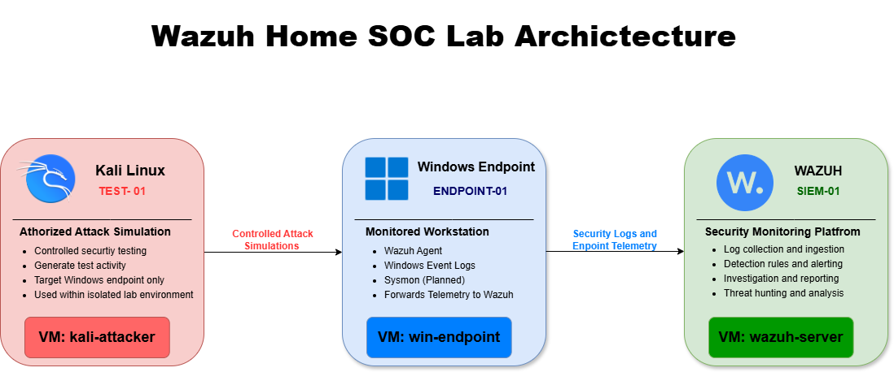

# Home SOC Lab Architecture
**Architecture Overview**

This lab uses Oracle VirtualBox to host an isolated three-VM security monitoring environment. The Kali Linux VM functions as the authorized attack-simulation system, the Windows VM acts as the monitored endpoint, and the Wazuh VM operates as the SIEM. Security activity generated against the Windows endpoint is recorded and forwarded to Wazuh for detection, analysis, and investigation.

**Architecture Diagram**

The diagram below shows the flow of controlled testing activity and endpoint telemetry within the isolated lab environment.

**Kali Linux Test System**

The Kali Linux virtual machine is used to generate safe, controlled security activity against the Windows endpoint within the isolated lab environment. Testing is limited to systems that I own and operate and is not conducted against public systems, third-party services, or unauthorized devices.

* **Asset ID:** TEST-01
* **Hostname:** kali-attacker
* **IP address:** [REDACTED]
* **Role:** security-testing system

**Windows Endpoint**

The Windows virtual machine serves as the monitored endpoint and generates Windows event logs and endpoint telemetry. The Wazuh agent collects and forwards the configured telemetry to the Wazuh server for analysis. Sysmon is planned to provide additional visibility into process creation, command-line execution, network connections, file activity, and registry changes.

* **Asset ID:** ENDPOINT-01
* **Hostname:** win-endpoint
* **IP address:** [REDACTED]
* **Role:** Monitored Windows workstation

**Wazuh Server**

Wazuh serves as the Security Information and Event Management (SIEM) platform for this lab. It collects and analyzes security telemetry from the Windows endpoint, applies detection rules, and provides centralized alerting, search, visualization, and investigation capabilities.

* **Asset ID:** SIEM-01
* **Hostname:** wazuh-server
* **IP address:** [REDACTED]
* **Role:** Central security monitoring platform

**Data Flow**

1.	The Kali Linux VM generates controlled activity within the authorized lab.
2.	The Windows endpoint records the resulting system and security activity.
3.	The Wazuh agent collects the configured Windows telemetry.
4.	The Wazuh server analyzes and indexes the collected events.
5.	The analyst reviews the evidence and determines whether the activity is benign, suspicious, or malicious.\

**Network Isolation**

All three virtual machines operate within an isolated virtual network.

The testing system is restricted to authorized lab systems. Sensitive information such as credentials, agent keys, tokens, MAC addresses, and private system identifiers is excluded from the public repository.

Current Architecture Status

* Wazuh virtual machine created
* Windows virtual machine created
* Kali Linux virtual machine created
* Windows Wazuh agent installed and validated
* Kali Linux Wazuh agent installed and validated
* Architecture diagram added
* Oracle VirtualBox network type documented
* Kali to Windows connectivity validated
* Windows to Wazuh connectivity validated
* Windows security-log collection validated
* Kali Linux log collection validated
* System time synchronization validated across all VMs
* Clean virtual-machine snapshots created

