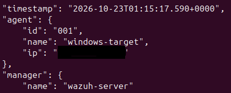
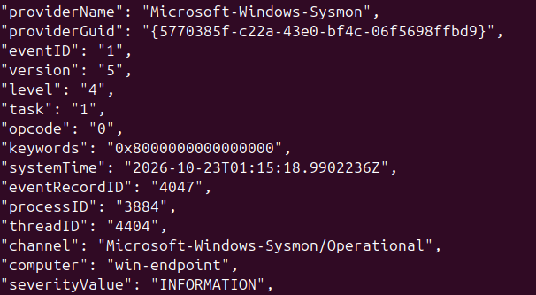
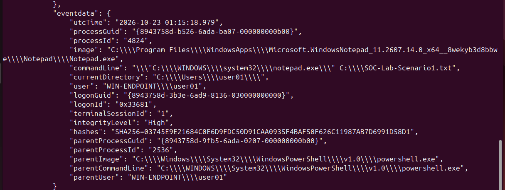
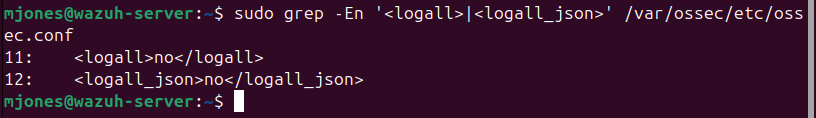

# Scenario 1: Sysmon Process-Creation Validation
## Local Sysmon Evidence

I generated a controlled Notepad process launch on ENDPOINT-01 using the unique command-line marker C:\SOC-Lab-Scenario1.txt. Sysmon recorded the activity as Process Create Event ID 1 and captured the executable path, command line, integrity level, SHA-256 hash, and parent-process information.

*Figure 1. Sysmon Event ID 1 recorded the controlled Notepad process launch on ENDPOINT-01. The unique command-line marker SOC-Lab-Scenario1.txt supports correlation with the centralized Wazuh archive record.*

## Wazuh Sysmon Collection Configuration
I configured the Wazuh agent on ENDPOINT-01 to collect events from the Sysmon Operational event channel. This configuration enables the agent to forward Sysmon telemetry to SIEM-01 for centralized collection and analysis.

*Figure 2. Windows Wazuh agent configuration for collecting events from the Microsoft-Windows-Sysmon/Operational event channel.*

## Centralized Wazuh Archive Evidence
I temporarily enabled JSON event archiving on SIEM-01 to verify that the controlled Notepad event was received by Wazuh even though the activity did not generate a visible Threat Hunting alert.

I searched the Wazuh JSON archive using the unique command-line marker SOC-Lab-Scenario1.txt. The resulting record identified the Windows agent, Sysmon provider, Event ID 1, Notepad executable, command line, integrity level, SHA-256 hash, and PowerShell parent process.

*Figure 3. Three views of the same Wazuh JSON archive record confirming receipt of the controlled Notepad Sysmon Event ID 1 from ENDPOINT-01. The unique marker SOC-Lab-Scenario1.txt correlates the local Sysmon record with the centralized Wazuh event.*

## Investigation and Correlation
I correlated the local Sysmon event with the centralized Wazuh archive record using the unique command-line marker SOC-Lab-Scenario1.txt.

The following fields matched across the endpoint and SIEM evidence:

* **Provider:** Microsoft-Windows-Sysmon
* **Event ID:** 1
* **Event type:** Process Create
* **Computer:** win-endpoint
* **Process image:** Notepad.exe
* **Command-line marker:** C:\SOC-Lab-Scenario1.txt
* **Integrity level:** High
* **Parent process:** powershell.exe
* **File hash algorithm:** SHA-256

The matching command line and timestamp established that the local Sysmon record and centralized Wazuh archive record represented the same controlled process launch.

## Event and Alert Analysis
The controlled Notepad process launch was successfully received by Wazuh, but it did not appear in the Threat Hunting alert index.

This occurred because the benign Notepad process did not match an alert-generating detection rule under the current Wazuh ruleset. I temporarily enabled JSON event archiving to confirm that Wazuh received the event even though no visible security alert was generated.

This test demonstrated that event collection and alert generation are separate stages:

1. Sysmon records endpoint activity.
2. The Wazuh agent forwards the configured telemetry.
3. The Wazuh server receives and processes the event.
4. A visible alert is created only when the event matches applicable detection logic.

## Findings
### Evidence Proves
* Notepad was launched on ENDPOINT-01.
* Sysmon recorded the activity as Process Create Event ID 1.
* PowerShell was the parent process.
* The Windows Wazuh agent collected and forwarded the Sysmon event.
* SIEM-01 received and archived the event.
* The unique marker SOC-Lab-Scenario1.txt correlated the local and centralized records.

### Evidence Does Not Prove
* Malicious activity occurred.
* The Windows endpoint was compromised.
* Unauthorized access occurred.
* Persistence was established.
* Data was accessed or exfiltrated.
* Incident containment was necessary.

### Visibility Limitation
The event was available in the Wazuh JSON archive but did not appear in the Threat Hunting alert index because the controlled Notepad execution did not match an alert-generating rule.

## Final Disposition
* **Activity:** Controlled Notepad process launch
* **Classification:** Authorized benign activity
* **Severity:** Informational
* **Confidence:** High
* **Security incident:** No
* **Escalation required:** No
* **Containment required:** No
* **Remediation required:** No

## MITRE ATT&CK Mapping
No MITRE ATT&CK technique was assigned to this scenario.

Sysmon Event ID 1 confirms that a process was created, but an ordinary Notepad launch does not provide sufficient evidence of adversary behavior. Assigning an ATT&CK technique based only on normal process execution would overstate the available evidence.

## Cleanup
JSON event archiving was enabled temporarily to validate receipt of the benign event. After the Wazuh archive record was collected, the archive settings were restored to:

*Figure 4. Wazuh JSON event archiving was returned to its original disabled state after the controlled validation test.*

## Lessons Learned
* Installing a telemetry source does not automatically prove centralized collection.
* A collected event does not automatically generate a security alert.
* A unique command-line marker supports reliable endpoint-to-SIEM correlation.
* Local and UTC timestamps must be compared carefully during investigations.
* Normal process execution should not be classified as malicious without supporting evidence.
* Temporary full-event archiving should be disabled after validation to reduce unnecessary storage usage.

## Scenario Completion Checklist
* Sysmon installed on ENDPOINT-01
* Sysmon service confirmed running
* Sysmon Event ID 1 validated locally
* Sysmon Operational channel added to the Windows Wazuh agent
* Windows Wazuh agent remained Active
* Unique Notepad test event generated
* Exact event located in the Wazuh JSON archive
* Local and centralized evidence correlated
* Event-versus-alert distinction documented
* Final disposition recorded
* Temporary JSON event archiving disabled
* Public evidence reviewed and sanitized

