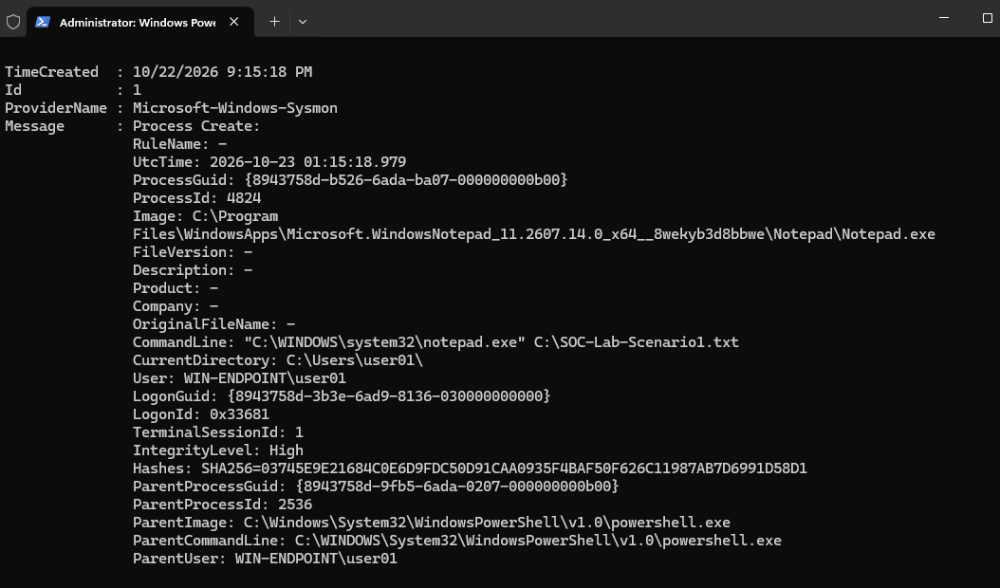
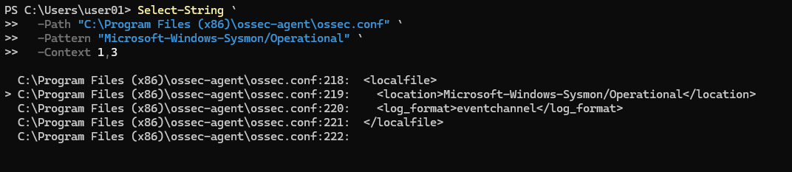

# Scenario 1: Sysmon Process-Creation Validation
## Local Sysmon Evidence

I generated a controlled Notepad process launch on ENDPOINT-01 using the unique command-line marker C:\SOC-Lab-Scenario1.txt. Sysmon recorded the activity as Process Create Event ID 1 and captured the executable path, command line, integrity level, SHA-256 hash, and parent-process information.

*Figure 1. Sysmon Event ID 1 recorded the controlled Notepad process launch on ENDPOINT-01. The unique command-line marker SOC-Lab-Scenario1.txt supports correlation with the centralized Wazuh archive record.*

# Wazuh Sysmon Collection Configuration
I configured the Wazuh agent on ENDPOINT-01 to collect events from the Sysmon Operational event channel. This configuration enables the agent to forward Sysmon telemetry to SIEM-01 for centralized collection and analysis.

*Figure 2. Windows Wazuh agent configuration for collecting events from the Microsoft-Windows-Sysmon/Operational event channel.*
