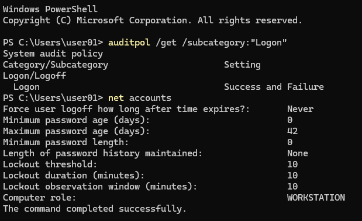
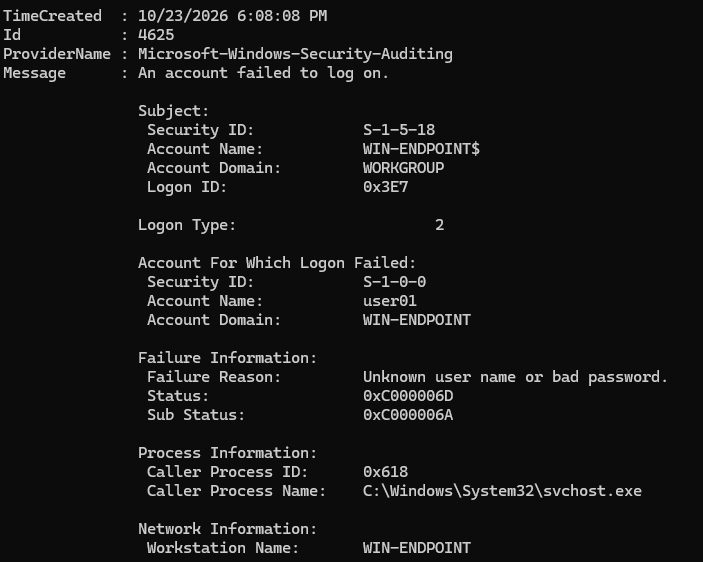
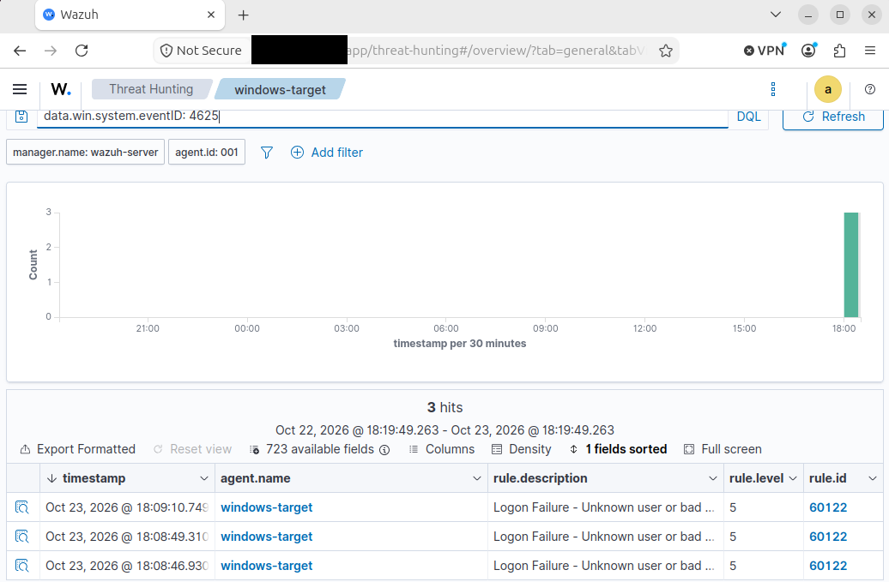

# Scenario 2: Controlled Failed Windows Logons

## Scenario Objective

Validate the collection, detection, and investigation of controlled Windows authentication failures on ENDPOINT-01.

The scenario confirmed that Windows recorded the failed sign-in attempts as Security Event ID `4625` and that the Windows Wazuh agent forwarded the corresponding authentication telemetry to SIEM-01.

Event ID `4625` represents an account failing to log on and is generated on the computer where the failed authentication attempt occurred.

## Environment

- **Target system:** ENDPOINT-01
- **Operating system:** Windows 11
- **Wazuh agent name:** `windows-target`
- **Wazuh agent ID:** `001`
- **SIEM:** SIEM-01
- **Test account:** Dedicated local lab account
- **Test location:** Windows lock screen
- **Planned failed attempts:** Three
- **Authorization:** Testing restricted to systems that I own and operate

TEST-01 was not required for this scenario because the controlled authentication failures were generated locally on ENDPOINT-01.

## Safety Controls

Before testing, I reviewed the Windows account-lockout policy and limited the test to three incorrect-password attempts.

The purpose was to generate failed-logon telemetry, not to test password strength, trigger an account lockout, perform brute force, or simulate password spraying.

The following safety controls were applied:

- Use only a dedicated lab account.
- Confirm the correct password before locking Windows.
- Review the account-lockout threshold.
- Remain below the configured lockout threshold.
- Stop testing if the account becomes locked.
- Do not record or publish the password.
- Do not test accounts or systems outside the authorized lab.

## Prerequisite Validation

### Failed-Logon Auditing

I reviewed the Windows Logon audit policy using:

```powershell
auditpol /get /subcategory:"Logon"
```

- **Observed result:** Success and Failure
- **Validation status:** Pass

The result confirmed that ENDPOINT-01 was configured to audit both successful and failed logon activity.

### Account-Lockout Policy

I reviewed the local account policy using:

```powershell
net accounts
```

The relevant settings were:

- **Lockout threshold:** 10 failed attempts
- **Lockout duration:** 10 minutes
- **Lockout observation window:** 10 minutes
- **Planned failed attempts:** Three
- **Validation status:** Pass

The controlled test remained safely below the configured lockout threshold.

### Wazuh Agent Status

Before generating the authentication failures, I confirmed that the Wazuh agent on ENDPOINT-01 was running and that the endpoint appeared as Active in Wazuh.

- **Wazuh service status:** Running
- **Wazuh dashboard status:** Active
- **Validation status:** Pass

### Prerequisite Evidence

Failed-logon auditing was enabled for successful and failed logon events. The local account-lockout threshold was configured for 10 failed attempts, so I limited the controlled test to three incorrect-password attempts.



*Figure 1. Windows Logon auditing was configured for Success and Failure. The account-lockout threshold was 10 attempts, with a 10-minute lockout duration and a 10-minute observation window. The controlled test was limited to three failed attempts.*

## Controlled Activity

I generated three controlled incorrect-password attempts against the dedicated local lab account `user01` at the Windows lock screen on ENDPOINT-01.

After the three failed attempts, I signed in using the correct password and stopped the test. The activity remained safely below the configured lockout threshold of 10 attempts.

### Test Record

- **Test date:** October 23, 2026
- **Target endpoint:** ENDPOINT-01
- **Target account:** `user01`
- **Test location:** Windows lock screen
- **Failed attempts generated:** Three
- **Subsequent successful sign-in:** Yes
- **Unexpected account lockout:** No

## Local Windows Evidence

Windows recorded the controlled authentication failures as Security Event ID `4625`.

The selected event represents one of the three controlled failed sign-in attempts and contains the following evidence:

- **Time created:** October 23, 2026 at 6:08:08 PM
- **Event ID:** `4625`
- **Provider:** `Microsoft-Windows-Security-Auditing`
- **Message:** An account failed to log on
- **Target account:** `user01`
- **Target domain:** `WIN-ENDPOINT`
- **Logon type:** `2`
- **Failure reason:** Unknown user name or bad password
- **Status:** `0xC000006D`
- **Sub-status:** `0xC000006A`
- **Caller process:** `C:\Windows\System32\svchost.exe`
- **Workstation name:** `WIN-ENDPOINT`

Logon Type `2` is consistent with an interactive sign-in attempt at the Windows console, matching the controlled lock-screen test.



*Figure 2. Windows Security Event ID 4625 recorded one of three controlled failed interactive sign-in attempts on ENDPOINT-01. The event identified Logon Type 2, the target account, failure reason, status and sub-status codes, caller process, and workstation.*

## Wazuh Detection Evidence

I searched Wazuh Threat Hunting for Windows Security Event ID `4625` using:

```text
data.win.system.eventID:4625
```

The search was restricted to Wazuh agent ID `001`, representing the monitored Windows endpoint.

Wazuh displayed three Event ID `4625` alerts during the selected time range:

- **Agent name:** `windows-target`
- **Agent ID:** `001`
- **Event ID:** `4625`
- **Rule ID:** `60122`
- **Rule level:** `5`
- **Rule description:** Logon Failure - Unknown user or bad password
- **Displayed alerts:** Three
- **First displayed timestamp:** October 23, 2026 at 6:08:46.930 PM
- **Second displayed timestamp:** October 23, 2026 at 6:08:49.310 PM
- **Third displayed timestamp:** October 23, 2026 at 6:09:10.749 PM



*Figure 3. Wazuh Threat Hunting displayed three Event ID 4625 alerts from the monitored Windows endpoint. Rule ID `60122`, at rule level `5`, classified the activity as a logon failure involving an unknown username or incorrect password.*

## Investigation and Correlation

I compared the local Windows Security evidence with the failed-logon alerts displayed in Wazuh.

The following evidence was consistent across the local and centralized records:

- **Endpoint:** ENDPOINT-01
- **Wazuh agent:** `windows-target`
- **Windows Event ID:** `4625`
- **Target account:** `user01`
- **Target domain:** `WIN-ENDPOINT`
- **Logon type:** `2`
- **Failure reason:** Unknown user name or bad password
- **Status:** `0xC000006D`
- **Sub-status:** `0xC000006A`
- **Workstation:** `WIN-ENDPOINT`
- **Wazuh rule ID:** `60122`
- **Wazuh rule level:** `5`
- **Controlled failed attempts:** Three
- **Wazuh alerts displayed:** Three

The number of Wazuh alerts matched the number of intentional failed-password attempts.

The matching endpoint, Event ID, account context, failure information, alert count, and test window supported the conclusion that Wazuh successfully detected the controlled failed-logon activity.

## SOC Investigation Workflow

### Alert Triage

I reviewed:

1. The affected endpoint
2. The target account
3. The number and timing of failed attempts
4. The logon type
5. The failure reason
6. The status and sub-status codes
7. The caller process
8. The workstation name
9. The corresponding Wazuh rule
10. Whether the expected account remained accessible after the test

### Initial Validation

I compared the observed events with:

- The documented test window
- The expected Windows endpoint
- The dedicated lab account
- The expected interactive Logon Type `2`
- The recorded failure reason and status codes
- The number of intentional failed attempts
- The number of Wazuh alerts
- The subsequent successful sign-in

### Scope Determination

I reviewed the available evidence for:

- Additional Event ID `4625` records involving `user01`
- Failed attempts involving other accounts
- Authentication failures outside the authorized test window
- Unexpected source addresses
- Similar failed-logon activity on other endpoints
- A subsequent successful sign-in

### False-Positive and Benign-Activity Analysis

Common benign explanations for Event ID `4625` include:

- A user entering an incorrect password
- Stored credentials containing an outdated password
- A scheduled task or service using outdated credentials
- A mapped resource attempting to authenticate with invalid credentials
- An authorized security test

In this scenario, the documented test context, target account, endpoint, interactive Logon Type `2`, limited number of attempts, and matching Wazuh alert count supported an authorized benign explanation.

## Findings

### Evidence Proves

- Three controlled failed sign-in attempts were generated on ENDPOINT-01.
- Windows rejected the interactive sign-in attempts.
- Windows recorded the failures as Security Event ID `4625`.
- The failed attempts targeted the local account `user01`.
- The representative event used Logon Type `2`, consistent with an interactive console sign-in.
- The failure reason was recorded as an unknown username or incorrect password.
- The Windows Wazuh agent forwarded failed-logon telemetry to SIEM-01.
- Wazuh displayed three Event ID `4625` alerts.
- The Wazuh alert count matched the number of controlled failed attempts.
- Wazuh rule `60122` generated level `5` alerts for the failed-logon activity.

### Evidence Suggests

- The three Wazuh alerts were consistent with the three controlled failed-password attempts.
- The activity remained limited to the designated Windows lab endpoint and account.
- The detection logic operated as expected for the controlled authentication failures.

### Evidence Does Not Prove

- A brute-force attack occurred.
- Password spraying occurred.
- Credentials were stolen.
- The account was compromised.
- Unauthorized access succeeded.
- Malicious intent existed.
- Incident containment was required.

## Event and Alert Analysis

The failed logon events were expected because they were intentionally generated as part of the authorized test.

Wazuh correctly generated alerts for the failed-logon behavior, making the detection a true positive. The underlying activity remained benign because it was performed intentionally within the controlled lab.

This scenario demonstrated the distinction between:

- **Event:** Windows recorded each failed authentication attempt as Event ID `4625`.
- **Alert:** Wazuh rule `60122` identified the failed-logon behavior and generated level `5` alerts.
- **Incident:** No security incident occurred because the activity was authorized, limited, and successfully validated.

## MITRE ATT&CK Mapping

No MITRE ATT&CK technique was assigned to this scenario.

Three manually generated failed-logon attempts do not provide sufficient evidence of Brute Force behavior. A mapping to Brute Force would require stronger supporting evidence, such as automated attempts, significant volume, repeated timing patterns, multiple targeted accounts, or other indications of adversary activity.

- **Tactic:** Not assigned
- **Technique:** Not assigned
- **Technique ID:** Not assigned
- **Confidence:** High
- **Reason:** The limited and authorized test demonstrated failed-authentication telemetry rather than adversary behavior.

## Final Disposition

- **Activity:** Three controlled failed Windows logons
- **Classification:** Authorized benign true positive
- **Severity:** Low
- **Confidence:** High
- **Security incident:** No
- **Escalation required:** No
- **Containment required:** No
- **Remediation required:** No

The detection was classified as a true positive because Wazuh correctly identified the failed-logon behavior. The underlying activity was benign because it was intentionally generated within the authorized test window.

The final severity was assessed as Low because Wazuh generated rule-level `5` alerts that required analyst validation. The documented authorization, limited volume, and successful account recovery reduced the activity from a potential authentication concern to a benign test result.

## Containment and Remediation

No containment or remediation was required because:

- The activity matched the authorized test plan.
- The expected lab account was targeted.
- The attempts remained below the lockout threshold.
- The account was not locked.
- The correct password remained functional.
- No evidence of successful unauthorized access was identified.

For a similar unauthorized pattern in a production environment, potential response actions would include:

1. Validate the activity with the account owner.
2. Review related failed and successful logons.
3. Identify the source system and authentication path.
4. Determine whether the failures continued after the initial alert.
5. Reset credentials if compromise is suspected.
6. Temporarily restrict the account if credible risk exists.
7. Review account-lockout and multifactor-authentication controls.
8. Increase monitoring for additional authentication attempts.

## Cleanup

The test did not create files, modify accounts, or change passwords.

Cleanup consisted of:

- Confirming that the correct account password remained functional
- Verifying that the account was not locked
- Confirming that the Wazuh agent remained Active
- Preserving the local Windows and Wazuh evidence
- Leaving failed-logon auditing enabled for continued SOC monitoring

## Lessons Learned

- Event ID `4625` records failed authentication but does not independently prove malicious intent.
- Logon Type `2` is consistent with an interactive sign-in at the Windows console.
- Status and sub-status codes provide important context for authentication failures.
- Account-lockout settings should be reviewed before generating controlled failures.
- A small number of failed logons should not automatically be classified as brute force.
- Wazuh rule information must be copied from the actual environment rather than assumed.
- Alert counts should be compared with the documented test record.
- A detection can be a true positive while the underlying activity remains authorized and benign.

## Scenario Completion Checklist

- [x] Failed-logon auditing verified
- [x] Account-lockout threshold reviewed
- [x] Controlled test window documented
- [x] Three intentional failed logons generated
- [x] Windows Event ID `4625` located locally
- [x] Relevant Event ID `4625` fields reviewed
- [x] Three corresponding Wazuh alerts located
- [x] Wazuh alert count matched the controlled test count
- [x] Actual Wazuh rule ID, level, and description recorded
- [x] Local and centralized evidence correlated
- [x] Event-versus-alert distinction documented
- [x] Final disposition recorded
- [x] Public evidence reviewed and sanitized

## Scenario Status

**Status:** Complete

**Final finding:** Windows recorded the three controlled failed sign-in attempts as Security Event ID `4625`, and Wazuh generated three corresponding rule-level `5` alerts under rule ID `60122`. The activity was classified as an authorized benign true positive with Low severity and High confidence.
