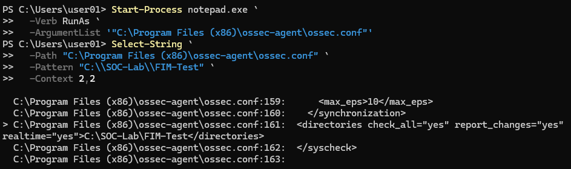
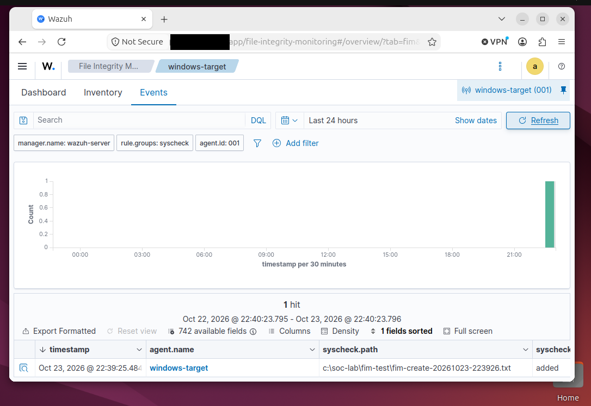
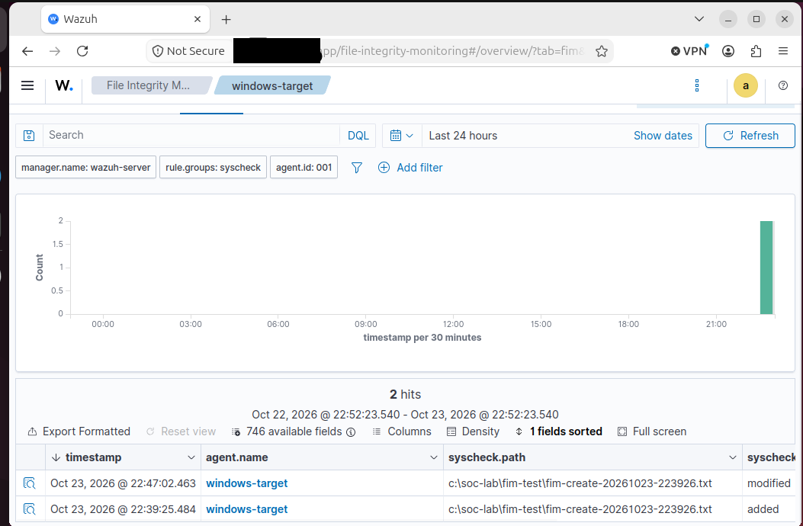
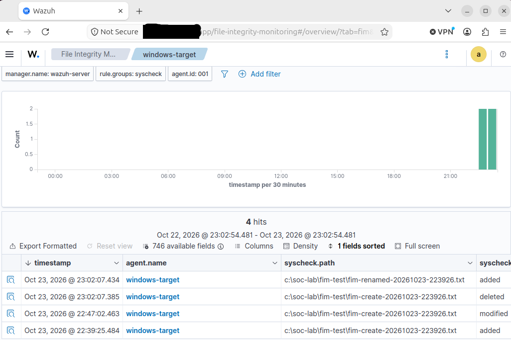
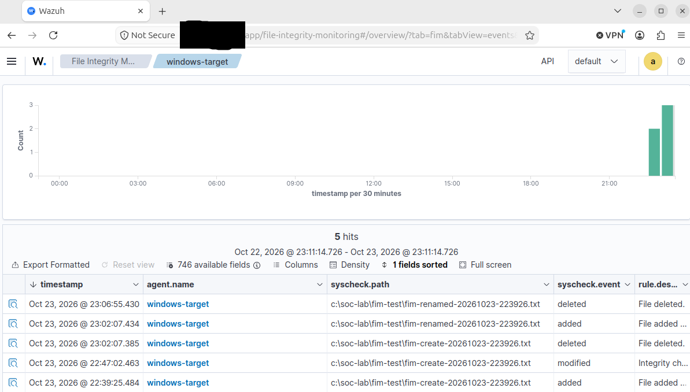

# Scenario 3: File Integrity Monitoring

## Executive Summary

This scenario validates whether Wazuh File Integrity Monitoring detects controlled file activity on ENDPOINT-01.

I will configure Wazuh to monitor a dedicated Windows test directory, generate safe file creation, modification, rename, and deletion activity, and investigate the corresponding Wazuh alerts.

## Objective

Validate the complete File Integrity Monitoring telemetry path:

1. A controlled file change occurs on ENDPOINT-01.
2. The Windows Wazuh agent detects the change.
3. The agent forwards the FIM telemetry to SIEM-01.
4. Wazuh generates and displays the corresponding alert.
5. The alert is investigated and assigned an evidence-based disposition.

## Environment

- **Monitored asset:** ENDPOINT-01
- **Operating system:** Windows 11
- **Wazuh agent:** `windows-target`
- **Wazuh agent ID:** `001`
- **SIEM:** SIEM-01
- **Test directory:** `C:\SOC-Lab\FIM-Test`
- **Test file:** `scenario3-test.txt`
- **Authorization:** Testing restricted to systems that I own and operate

TEST-01 is not required because the controlled file activity will be generated locally on ENDPOINT-01.

## Safety Controls

The scenario uses a dedicated test directory containing no personal, operational, or system files.

Safety controls include:

- Monitor only `C:\SOC-Lab\FIM-Test`.
- Do not monitor the entire Windows drive for this test.
- Use only harmless text content.
- Do not modify Windows system files.
- Back up the Wazuh agent configuration before editing it.
- Validate the XML configuration before restarting the agent.
- Keep file activity restricted to the authorized test directory.
- Preserve screenshots only after reviewing them for sensitive information.

## Planned File Activity

The controlled test will perform these actions:

1. Create `scenario3-test.txt`.
2. Add harmless text to the file.
3. Rename the file to `scenario3-renamed.txt`.
4. Delete the renamed file.
5. Review the resulting Wazuh alerts.

## Expected Data Source

- Wazuh File Integrity Monitoring
- Windows Wazuh agent telemetry
- Monitored directory: `C:\SOC-Lab\FIM-Test`

## FIM Configuration Evidence

I configured the Wazuh agent on ENDPOINT-01 to monitor the dedicated test directory `C:\SOC-Lab\FIM-Test`.

The configuration enabled real-time monitoring, supported file-attribute checks, and text-change reporting.

*Figure 1. The Wazuh agent on ENDPOINT-01 was configured to monitor `C:\SOC-Lab\FIM-Test` using real-time File Integrity Monitoring.*

## File-Creation Evidence

After confirming that real-time FIM monitoring was active, I created a uniquely named text file inside the monitored directory:

`C:\SOC-Lab\FIM-Test\fim-create-20261023-223926.txt`

Wazuh detected the file as added and displayed the corresponding event for the `windows-target` agent.

*Figure 2. Wazuh File Integrity Monitoring detected the controlled creation of `fim-create-20261023-223926.txt` on ENDPOINT-01. The `syscheck.event` value identified the action as `added`.*

## File-Modification Evidence

After validating the file-creation event, I added controlled text content to the same monitored file.

Wazuh recorded a second FIM event for:

`C:\SOC-Lab\FIM-Test\fim-create-20261023-223926.txt`

The event timeline showed the file first as `added` and later as `modified`.

*Figure 3. Wazuh File Integrity Monitoring recorded the controlled file as added and later modified on ENDPOINT-01. The matching path and chronological event actions confirmed that real-time FIM monitoring detected both changes.*

## File-Rename Evidence

I renamed the monitored file from:

`C:\SOC-Lab\FIM-Test\fim-create-20261023-223926.txt`

to:

`C:\SOC-Lab\FIM-Test\fim-renamed-20261023-223926.txt`

Wazuh represented the rename as two closely timed FIM events:

- The original path was recorded as `deleted`.
- The renamed path was recorded as `added`.

*Figure 4. Wazuh represented the controlled file rename as a deletion of the original path and an addition of the renamed path. The closely timed events and matching directory context supported correlation to the same rename operation.*

## File-Deletion Evidence

After validating the rename-related events, I deleted the renamed test file:

`C:\SOC-Lab\FIM-Test\fim-renamed-20261023-223926.txt`

Wazuh recorded a final FIM event with the action `deleted`. The event completed the controlled file lifecycle of creation, modification, renaming, and deletion.

*Figure 5. Wazuh File Integrity Monitoring detected deletion of the renamed test file on ENDPOINT-01. The event list shows the complete controlled sequence: the original file was added and modified, the rename appeared as deletion of the original path and addition of the new path, and the renamed file was subsequently deleted.*

## Evidence of Interest

The investigation will review:

- Agent name
- Event timestamp
- File path
- File action
- Wazuh rule ID
- Wazuh rule description
- Wazuh rule level
- Previous and current file hashes, when available
- File size
- File attributes
- Content differences, when available
- Detection delay
- User or process information, when available

The report will not claim that Wazuh identified the responsible user or process unless those fields are present in the actual FIM event.

## Prerequisite Validation

The following items must be completed before generating file activity:

- [ ] Clean Windows snapshot created
- [ ] Dedicated test directory created
- [ ] Wazuh agent configuration backed up
- [ ] Existing `<syscheck>` configuration located
- [ ] Test directory added to the FIM configuration
- [ ] XML configuration validated
- [ ] Wazuh agent restarted successfully
- [ ] ENDPOINT-01 remained Active
- [ ] Initial FIM baseline allowed to complete

## Controlled Test Status

- [ ] Test file created
- [ ] Test file modified
- [ ] Test file renamed
- [ ] Test file deleted
- [ ] File-addition alert located in Wazuh
- [ ] File-modification alert located in Wazuh
- [ ] Rename behavior reviewed
- [ ] File-deletion alert located in Wazuh
- [ ] Alert fields investigated
- [ ] Final disposition recorded
- [ ] Evidence reviewed and sanitized

## MITRE ATT&CK Assessment

No MITRE ATT&CK technique has been assigned at this stage.

Normal file creation, modification, renaming, and deletion do not independently prove adversary behavior. Any ATT&CK mapping will be based only on behavior supported by the collected evidence.

## Scenario Status

**Status:** In progress

**Current finding:** File Integrity Monitoring configuration and controlled testing are pending.
