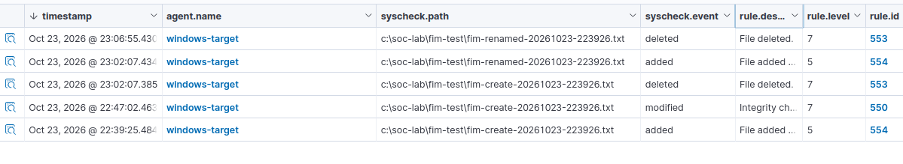

# Scenario 3: File Integrity Monitoring

## Executive Summary

I configured Wazuh File Integrity Monitoring to monitor a dedicated directory on ENDPOINT-01 and generated controlled file creation, modification, rename, and deletion activity.

Wazuh successfully detected all file changes in real time. File additions triggered rule `554`, the content modification triggered rule `550`, and deletions triggered rule `553`. The rename appeared as two related events: deletion of the original path and addition of the renamed path.

## Objective

Validate the complete File Integrity Monitoring workflow:

1. A controlled file change occurs on ENDPOINT-01.
2. The Windows Wazuh agent detects the change.
3. The agent forwards the FIM telemetry to SIEM-01.
4. Wazuh generates and displays the corresponding alert.
5. The analyst reviews the evidence and assigns an appropriate disposition.

## Environment

- **Monitored asset:** ENDPOINT-01
- **Operating system:** Windows 11
- **Wazuh agent:** `windows-target`
- **Wazuh agent ID:** `001`
- **SIEM:** SIEM-01
- **Monitored directory:** `C:\SOC-Lab\FIM-Test`
- **Authorization:** Testing restricted to systems that I own and operate

TEST-01 was not required because the controlled file activity was generated locally on ENDPOINT-01.

## Safety Controls

The scenario used a dedicated directory containing no personal, operational, or Windows system files.

The following controls were applied:

- Monitored only `C:\SOC-Lab\FIM-Test`.
- Used harmless text content.
- Did not modify Windows system files.
- Backed up the Wazuh agent configuration before editing it.
- Validated the XML before restarting the agent.
- Confirmed that the Wazuh agent remained Active.
- Restricted all file activity to the authorized test directory.
- Reviewed screenshots before publication.

## FIM Configuration

I added the following directory entry to the existing `<syscheck>` section of the Windows Wazuh agent configuration:

```xml
<directories check_all="yes" report_changes="yes" realtime="yes">C:\SOC-Lab\FIM-Test</directories>
```

This configuration enabled:

- Real-time monitoring
- File-size and attribute checks
- MD5, SHA-1, and SHA-256 hashing
- Supported text-change reporting

The XML structure was validated before the Wazuh agent was restarted. After the restart, the agent log confirmed that the custom path was actively monitored:

```text
Monitoring path: 'c:\soc-lab\fim-test'
```


*Figure 1. The Wazuh agent on ENDPOINT-01 was configured to monitor `C:\SOC-Lab\FIM-Test` using real-time File Integrity Monitoring.*

## Controlled File Activity

I generated the following controlled file lifecycle:

1. Created a uniquely named text file.
2. Added harmless text to modify its contents.
3. Renamed the file.
4. Deleted the renamed file.

The original path was:

```text
C:\SOC-Lab\FIM-Test\fim-create-20261023-223926.txt
```

The renamed path was:

```text
C:\SOC-Lab\FIM-Test\fim-renamed-20261023-223926.txt
```

## File-Creation Evidence

Wazuh detected creation of the original test file and recorded the action as `added`.


*Figure 2. Wazuh File Integrity Monitoring detected creation of `fim-create-20261023-223926.txt` on ENDPOINT-01. The `syscheck.event` value identified the action as `added`.*

## File-Modification Evidence

I added controlled text content to the original file. Wazuh recorded a second event for the same path with the action `modified`.


*Figure 3. Wazuh recorded the controlled file as added and later modified. The matching path and chronological events confirmed that real-time FIM detected both changes.*

## File-Rename Evidence

I renamed the original test file to:

```text
C:\SOC-Lab\FIM-Test\fim-renamed-20261023-223926.txt
```

Wazuh represented the rename as two closely timed events:

- The original path was recorded as `deleted`.
- The renamed path was recorded as `added`.

The events occurred approximately `0.049` seconds apart, supporting correlation to the same rename operation.


*Figure 4. Wazuh represented the controlled rename as deletion of the original path followed by addition of the renamed path.*

## Complete FIM Event Sequence

Wazuh recorded five events during the controlled file lifecycle:

1. Original file added
2. Original file modified
3. Original path deleted during the rename
4. Renamed path added
5. Renamed file deleted



*Figure 5. Wazuh recorded the complete controlled file lifecycle on ENDPOINT-01. Rule `554` detected additions, rule `550` detected modification, and rule `553` detected deletions.*

## Observed Wazuh Rules

| File action | Rule ID | Rule level | Observed description |
|---|---:|---:|---|
| Added | `554` | `5` | File added |
| Modified | `550` | `7` | Integrity checksum changed |
| Deleted | `553` | `7` | File deleted |

The rule information was recorded directly from the events in the local Wazuh environment.

## Investigation and Correlation

I correlated the file activity using:

- Wazuh agent name
- File path
- FIM action
- Event timestamp
- Rule ID
- Rule level
- Rule description
- Chronological event order

The matching directory, filenames, timestamps, and actions established the following sequence:

```text
Created → Modified → Renamed → Deleted
```

The rename did not appear as a single event labeled `renamed`. Instead, Wazuh recorded deletion of the original path followed by addition of the new path.

## Findings

### Evidence Proves

- Wazuh monitored `C:\SOC-Lab\FIM-Test` in real time.
- The Windows Wazuh agent detected controlled file creation.
- Wazuh detected a content modification to the original file.
- Wazuh represented the rename as deletion of the original path and addition of the renamed path.
- Wazuh detected deletion of the renamed file.
- Rules `550`, `553`, and `554` operated as expected.
- The event sequence matched the controlled test activity.

### Evidence Does Not Prove

- Malware performed the file changes.
- An attacker accessed the endpoint.
- The Windows endpoint was compromised.
- The file changes established persistence.
- Data was accessed or exfiltrated.
- Wazuh identified the responsible process or user.
- A security incident occurred.

## Visibility Limitation

The available FIM evidence identified the affected path, file action, timestamp, rule, and agent.

The displayed events did not provide sufficient evidence to attribute every change to a specific user or process. No user or process attribution was claimed without corresponding supported fields.

## Event and Alert Classification

The file operations were real changes recorded by Wazuh, and the FIM rules correctly identified each action.

The detections were therefore **true positives**. The underlying activity was **benign** because the changes were authorized and intentionally generated inside the dedicated test directory.

No security incident occurred.

## MITRE ATT&CK Assessment

No MITRE ATT&CK technique was assigned.

Normal file creation, modification, renaming, and deletion do not independently prove adversary behavior. A defensible ATT&CK mapping would require additional evidence connecting the file activity to a specific adversary objective or technique.

Avoiding an unsupported mapping preserved the accuracy of the investigation.

## Final Disposition

- **Activity:** Controlled file creation, modification, rename, and deletion
- **Classification:** Authorized benign true positive
- **Severity:** Low
- **Confidence:** High
- **Security incident:** No
- **Escalation required:** No
- **Containment required:** No
- **Remediation required:** No

The Low severity reflects that Wazuh generated file-integrity alerts requiring analyst validation. The documented authorization, dedicated test directory, harmless file contents, and expected event sequence reduced the activity to a benign test result.

## Response Considerations

No containment or remediation was required because:

- The activity matched the authorized test plan.
- All changes occurred inside the dedicated test directory.
- No Windows system files were modified.
- The test used harmless text content.
- The final test file was deleted.
- No evidence of unauthorized access was identified.

For similar unauthorized activity, an analyst should:

1. Identify the affected asset and file path.
2. Review the file hash and available content differences.
3. Determine whether the change was expected or approved.
4. Review related process, user, and authentication telemetry.
5. Compare the file against a known-good version.
6. Isolate the endpoint if malicious activity is supported.
7. Restore the file from a trusted source if necessary.
8. Increase monitoring for related file changes.

## Cleanup

The renamed test file was deleted as the final controlled action.

The dedicated directory remained available for future FIM testing:

```text
C:\SOC-Lab\FIM-Test
```

The Wazuh FIM configuration remained enabled so the directory could continue supporting authorized detection testing.

The pre-change configuration backup was preserved as:

```text
C:\Program Files (x86)\ossec-agent\ossec.conf.pre-fim
```

## Skills Demonstrated

- Wazuh File Integrity Monitoring configuration
- XML configuration validation
- Real-time file-change monitoring
- File-path and event-timeline correlation
- Wazuh rule analysis
- File lifecycle investigation
- True-positive and benign-activity classification
- Evidence limitation analysis
- Severity and confidence assessment
- Technical documentation

## Lessons Learned

- A FIM alert proves that a monitored file changed, not why it changed.
- File renames may appear as deletion and addition events.
- Closely timed events can support correlation of related filesystem actions.
- File paths, timestamps, rule IDs, and actions should be reviewed together.
- User or process attribution should not be claimed unless the event contains supporting data.
- A detection can be accurate while the underlying activity remains authorized and benign.
- The monitored directory must be loaded successfully before controlled testing begins.

## Completion Checklist

- [x] Dedicated test directory created
- [x] Wazuh agent configuration backed up
- [x] Existing `<syscheck>` configuration located
- [x] Test directory added to the FIM configuration
- [x] XML configuration validated
- [x] Wazuh agent restarted successfully
- [x] ENDPOINT-01 remained Active
- [x] Initial FIM baseline completed
- [x] Real-time monitoring confirmed
- [x] Controlled test file created
- [x] File-creation alert located
- [x] Controlled test file modified
- [x] File-modification alert located
- [x] Controlled test file renamed
- [x] Rename behavior reviewed
- [x] Controlled test file deleted
- [x] File-deletion alert located
- [x] Actual Wazuh rule information documented
- [x] Investigation findings documented
- [x] Final disposition recorded
- [x] Public evidence reviewed and sanitized

## Scenario Status

**Status:** Complete

**Final finding:** Wazuh detected the complete controlled file lifecycle on ENDPOINT-01. Rule `554` detected file additions, rule `550` detected the content modification, and rule `553` detected deletions. The rename appeared as deletion of the original path followed by addition of the renamed path. The activity was classified as an authorized benign true positive with Low severity and High confidence.
