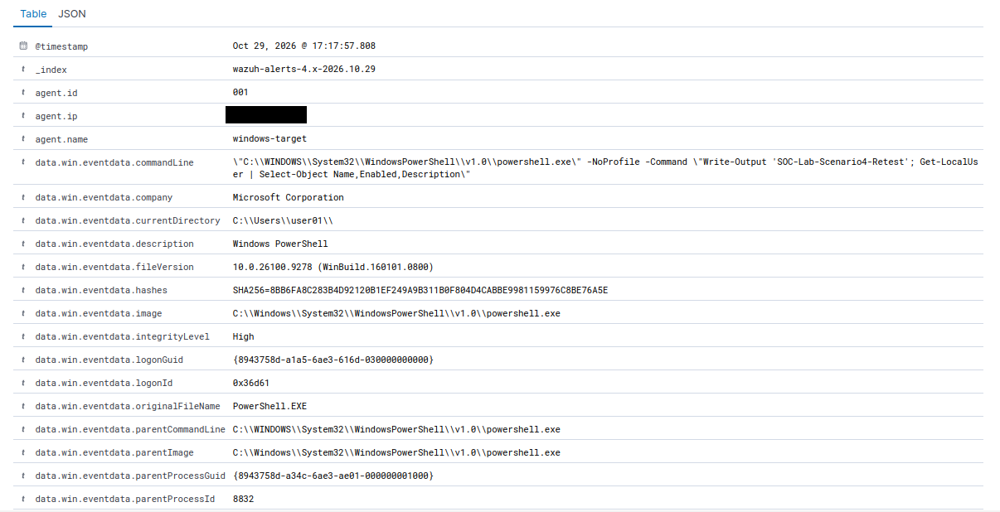
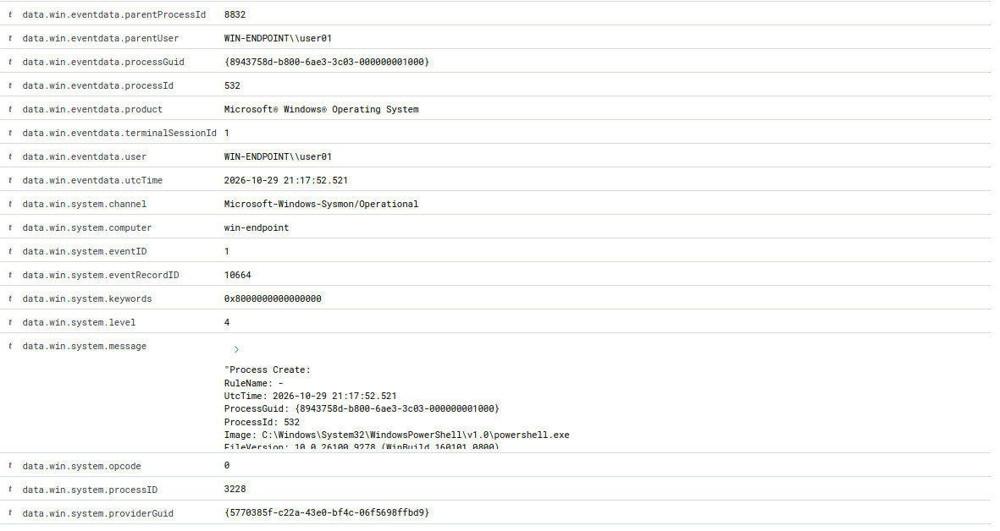
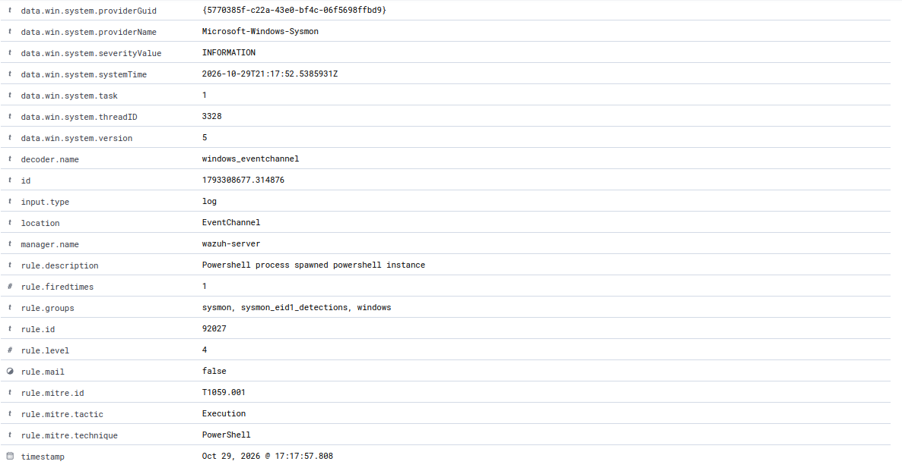

# Scenario 4: PowerShell Local-Account Discovery

## Executive Summary

I executed the read-only `Get-LocalUser` cmdlet on ENDPOINT-01 to validate visibility into controlled PowerShell execution and local-account discovery.

Sysmon recorded the child PowerShell process as Process Create Event ID `1`. Wazuh received the corresponding event and generated a level `4` alert under rule `92027`, **PowerShell process spawned PowerShell instance**.

The unique command-line marker `SOC-Lab-Scenario4-Retest` supported correlation between the controlled command, local Sysmon evidence, and centralized Wazuh alert.

## Objective

Validate whether Sysmon and Wazuh provide visibility into controlled PowerShell execution and local-account discovery on ENDPOINT-01.

The scenario demonstrates:

- PowerShell process analysis
- Full command-line review
- Parent-child process analysis
- Local-account discovery analysis
- Endpoint-to-SIEM correlation
- Wazuh rule validation
- MITRE ATT&CK assessment
- Event, alert, and incident classification

## Environment

- **Target asset:** ENDPOINT-01
- **Operating system:** Windows 11
- **Wazuh agent:** `windows-target`
- **Wazuh agent ID:** `001`
- **SIEM:** SIEM-01
- **Telemetry source:** Sysmon Event ID `1`
- **Controlled cmdlet:** `Get-LocalUser`
- **Scenario marker:** `SOC-Lab-Scenario4-Retest`
- **Authorization:** Testing restricted to systems that I own and operate

TEST-01 was not required because the controlled PowerShell activity was generated locally on ENDPOINT-01.

## Safety Controls

The scenario used a read-only PowerShell command.

The following controls were applied:

- Retrieved local-account information only.
- Did not create, delete, enable, or disable accounts.
- Did not change passwords or group memberships.
- Did not export account information outside the lab.
- Kept testing restricted to ENDPOINT-01.
- Confirmed that SIEM-01 and the Windows Wazuh agent were online.
- Excluded passwords, tokens, and unnecessary identifiers from screenshots.
- Reviewed evidence before publication.

## Prerequisite Validation

Before executing the controlled command, I confirmed that:

- `Get-LocalUser` was available.
- The cmdlet was provided by `Microsoft.PowerShell.LocalAccounts`.
- The Sysmon service was running.
- The Windows Wazuh agent was running.
- The `windows-target` agent appeared as Active in Wazuh.


*Figure 1. ENDPOINT-01 prerequisite validation confirmed that `Get-LocalUser` was available through the `Microsoft.PowerShell.LocalAccounts` module and that the Sysmon and Wazuh services were running.*

## Controlled PowerShell Activity

I launched a new child PowerShell process using the unique marker `SOC-Lab-Scenario4-Retest` and the read-only `Get-LocalUser` cmdlet.

The controlled command was:

```powershell
powershell.exe -NoProfile -Command "Write-Output 'SOC-Lab-Scenario4-Retest'; Get-LocalUser | Select-Object Name,Enabled,Description"
```

The command returned:

- Local account names
- Account enabled states
- Account descriptions

The command did not modify accounts, passwords, privileges, group memberships, or system configuration.


*Figure 2. The controlled PowerShell process executed `Get-LocalUser` on ENDPOINT-01 using the unique marker `SOC-Lab-Scenario4-Retest`. The read-only command returned local-account information without modifying account configuration.*

## Local Sysmon Evidence

Sysmon recorded the child PowerShell process as Process Create Event ID `1`.

The local event captured:

- **Provider:** `Microsoft-Windows-Sysmon`
- **Event ID:** `1`
- **Event type:** Process Create
- **Process image:** `powershell.exe`
- **Unique marker:** `SOC-Lab-Scenario4-Retest`
- **Discovery cmdlet:** `Get-LocalUser`
- **Selected properties:** `Name`, `Enabled`, and `Description`
- **Parent process:** `powershell.exe`
- **User context:** `WIN-ENDPOINT\user01`
- **Integrity level:** High
- **Hash algorithm:** SHA-256
- **Local timestamp:** October 29, 2026 at 5:17:52 PM
- **UTC timestamp:** October 29, 2026 at 9:17:52 PM

The complete command line established that PowerShell was used to retrieve information about local Windows accounts.


*Figure 3. Sysmon Event ID 1 recorded the controlled PowerShell account-discovery process on ENDPOINT-01. The complete command line contained `SOC-Lab-Scenario4-Retest` and the read-only `Get-LocalUser` cmdlet.*

## Centralized Wazuh Evidence

Wazuh received the corresponding Sysmon Process Create event from ENDPOINT-01.

The centralized record matched the local event through the following fields:

- **Agent:** `windows-target`
- **Agent ID:** `001`
- **Computer:** `win-endpoint`
- **Sysmon provider:** `Microsoft-Windows-Sysmon`
- **Event channel:** `Microsoft-Windows-Sysmon/Operational`
- **Event ID:** `1`
- **Process image:** `powershell.exe`
- **Unique marker:** `SOC-Lab-Scenario4-Retest`
- **Discovery cmdlet:** `Get-LocalUser`
- **Parent process:** `powershell.exe`
- **User context:** `WIN-ENDPOINT\user01`
- **Integrity level:** High
- **Hash algorithm:** SHA-256
- **Wazuh rule ID:** `92027`
- **Wazuh rule level:** `4`
- **Rule description:** PowerShell process spawned PowerShell instance
- **Wazuh-assigned MITRE technique:** `T1059.001`, PowerShell







*Figure 4. Three views of the timestamp-matched centralized Wazuh event. The record contained the unique marker `SOC-Lab-Scenario4-Retest`, the read-only `Get-LocalUser` cmdlet, Sysmon Process Create Event ID `1`, and Wazuh rule `92027` at level `4`. Wazuh mapped the event to `T1059.001`, PowerShell.*

## Investigation and Correlation

I correlated the local Sysmon event with the centralized Wazuh alert using:

- Endpoint and Wazuh agent
- Sysmon provider and event channel
- Event ID `1`
- Process image
- Complete command line
- Unique scenario marker
- Discovery cmdlet
- Parent process
- User context
- Integrity level
- Process hash
- Local, UTC, and Wazuh timestamps

The local Sysmon event occurred at approximately:

```text
October 29, 2026 at 5:17:52 PM
```

The Wazuh alert was indexed at approximately:

```text
October 29, 2026 at 5:17:57 PM
```

The approximately five-second difference was consistent with agent forwarding, Wazuh processing, and indexing delay.

The matching marker, command, process fields, host, event ID, and timestamps established that the local and centralized records represented the same controlled activity.

## Analyst Assessment

### Evidence Proves

- PowerShell executed on ENDPOINT-01.
- A child `powershell.exe` process was created.
- The command line contained `SOC-Lab-Scenario4-Retest`.
- The command line contained `Get-LocalUser`.
- The cmdlet returned local account information.
- Sysmon recorded the process as Event ID `1`.
- Wazuh received the corresponding Sysmon event.
- Wazuh generated a level `4` alert under rule `92027`.
- The parent process was another PowerShell process.
- The process ran with High integrity.
- A SHA-256 process hash was recorded.

### Evidence Does Not Prove

- The command was executed with malicious intent.
- An attacker accessed the endpoint.
- Credentials were stolen.
- Accounts were modified.
- Privileges were escalated.
- Persistence was established.
- Unauthorized access succeeded.
- A security incident occurred.

## Event, Alert, and Incident Classification

Sysmon recorded the PowerShell process as an **event**.

Wazuh rule `92027` matched the parent-child PowerShell behavior and generated an **alert**.

The detection was a **true positive** because the recorded PowerShell activity occurred as detected. The underlying activity was **benign** because the command was read-only, authorized, and intentionally executed within the lab.

The activity was not classified as a security incident.

## MITRE ATT&CK Assessment

### Wazuh-Assigned Mapping

The timestamp-matched Wazuh event displayed:

- **Tactic:** Execution
- **Technique:** Command and Scripting Interpreter: PowerShell
- **Technique ID:** `T1059.001`
- **Wazuh rule:** `92027`

This mapping reflected the use of PowerShell to execute the controlled command.

### Analyst-Assessed Mapping

The `Get-LocalUser` cmdlet retrieved information about local Windows accounts. This behavior was consistent with:

- **Tactic:** Discovery
- **Technique:** Account Discovery: Local Account
- **Technique ID:** `T1087.001`

`T1087.001` was an analyst-assessed behavioral mapping. It was not displayed as the Wazuh-assigned mapping in the timestamp-matched event.

### Intent Assessment

The ATT&CK mappings describe observable behavior, not malicious intent.

The command was:

- Read-only
- Authorized
- Limited to ENDPOINT-01
- Executed within the controlled lab
- Not associated with account modification or unauthorized access

## Final Disposition

- **Activity:** Controlled PowerShell local-account discovery
- **Classification:** Authorized benign true positive
- **Severity:** Low
- **Confidence:** High
- **Security incident:** No
- **Escalation required:** No
- **Containment required:** No
- **Remediation required:** No

Wazuh correctly identified the controlled PowerShell parent-child process behavior and generated a level `4` alert under rule `92027`.

The detection was classified as a true positive because the behavior occurred as recorded. The underlying activity remained benign because it was read-only, authorized, and performed within the controlled lab.

## Response Considerations

No response action was required because:

- The activity was authorized.
- The command was read-only.
- No account configuration was changed.
- No passwords or credentials were accessed.
- No unauthorized access occurred.
- The activity remained limited to ENDPOINT-01.

For similar unauthorized activity, an analyst should:

1. Identify the executing user and endpoint.
2. Review the complete PowerShell command line.
3. Determine whether additional discovery commands were executed.
4. Review related authentication and process activity.
5. Check for subsequent account changes or privilege escalation.
6. Validate the activity with the account owner.
7. Escalate if the discovery activity is unexplained or associated with other suspicious behavior.

## Cleanup

The test did not modify accounts, passwords, privileges, files, or system configuration.

After testing, I confirmed that:

- The local accounts remained unchanged.
- Sysmon remained operational.
- The Wazuh agent remained Active.
- The evidence was preserved and sanitized.
- No containment or remediation was required.

## Skills Demonstrated

- PowerShell process analysis
- Sysmon Event ID `1` analysis
- Full command-line review
- Parent-child process analysis
- Local-account discovery analysis
- Endpoint-to-SIEM correlation
- Wazuh rule validation
- MITRE ATT&CK assessment
- Intent and behavior separation
- True-positive classification
- Technical documentation

## Lessons Learned

- PowerShell usage does not independently prove malicious intent.
- `Get-LocalUser` provides read-only visibility into local account configuration.
- Unique command-line markers support reliable event correlation.
- Sysmon Event ID `1` provides process, command-line, parent-process, user, and hash context.
- Local and centralized timestamps should be compared with expected processing delay.
- Wazuh-assigned and analyst-assessed ATT&CK mappings should be clearly distinguished.
- An alert can be accurate while the underlying activity remains authorized and benign.

## Completion Checklist

- [x] `Get-LocalUser` availability verified
- [x] Sysmon service confirmed running
- [x] Wazuh agent confirmed running
- [x] ENDPOINT-01 confirmed Active
- [x] Test start time recorded
- [x] Controlled account-discovery command executed
- [x] Local Sysmon Event ID `1` located
- [x] Full command line confirmed
- [x] Timestamp-matched Wazuh event documented
- [x] Exact `SOC-Lab-Scenario4-Retest` marker confirmed in Wazuh
- [x] Wazuh rule ID, description, and level recorded
- [x] Wazuh-assigned MITRE ATT&CK mapping confirmed
- [x] Analyst-assessed discovery mapping documented
- [x] Local and centralized evidence correlated
- [x] Final disposition recorded
- [x] Public evidence reviewed and sanitized

## Scenario Status

**Status:** Complete

**Final finding:** Sysmon recorded the controlled `Get-LocalUser` process as Event ID `1`, and Wazuh generated a corresponding level `4` alert under rule `92027`. Wazuh mapped the event to `T1059.001`, PowerShell. The local-account discovery behavior was additionally assessed as consistent with `T1087.001`. The activity was classified as an authorized benign true positive with Low severity and High confidence.
