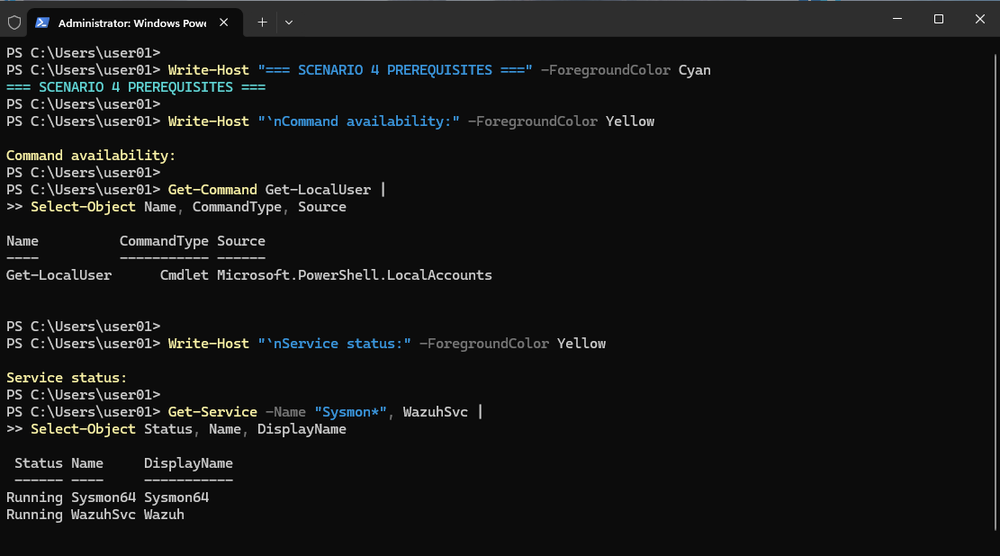
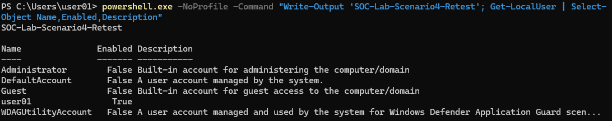
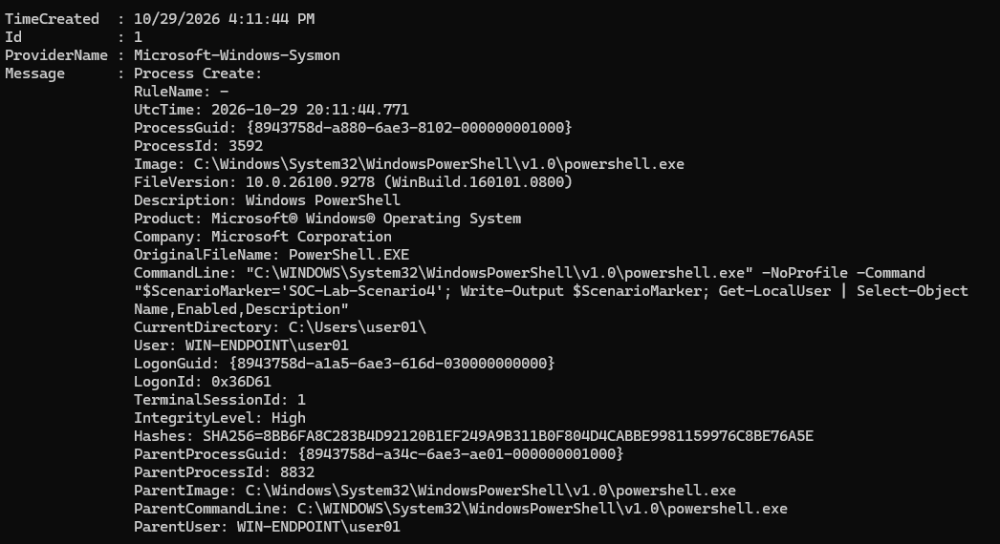

# Scenario 4: PowerShell Local-Account Discovery

## Executive Summary

This scenario evaluates visibility into controlled PowerShell execution and local-account discovery on ENDPOINT-01.

I used the read-only `Get-LocalUser` cmdlet to retrieve local Windows account information. Sysmon recorded the activity as Process Create Event ID `1`, including the complete command line, parent process, integrity level, user context, and SHA-256 process hash.

The unique marker `SOC-Lab-Scenario4-Retest` was embedded in the command line to support correlation between the local Sysmon event and centralized Wazuh telemetry.

## Objective

Validate whether Sysmon and Wazuh provide visibility into controlled PowerShell execution and local-account discovery on ENDPOINT-01.

The scenario was designed to demonstrate:

- PowerShell process analysis
- Full command-line review
- Parent-child process analysis
- Local-account discovery analysis
- Endpoint-to-SIEM telemetry correlation
- MITRE ATT&CK assessment
- Event and alert classification
- Evidence-based final disposition

## Environment

- **Target asset:** ENDPOINT-01
- **Operating system:** Windows 11
- **Wazuh agent:** `windows-target`
- **Wazuh agent ID:** `001`
- **SIEM:** SIEM-01
- **Telemetry source:** Sysmon Event ID `1`
- **Controlled cmdlet:** `Get-LocalUser`
- **Scenario marker:** `SOC-Lab-Scenario4-Retest`
- **Authorization:** Testing restricted to systems that I own and operate

TEST-01 was not required because the controlled PowerShell activity was generated locally on ENDPOINT-01.

## Safety Controls

The scenario used a read-only PowerShell command.

The following controls were applied:

- Retrieved local-account information only.
- Did not create, delete, enable, or disable accounts.
- Did not change passwords or group memberships.
- Did not export account information outside the lab.
- Kept testing restricted to ENDPOINT-01.
- Excluded passwords, tokens, and unnecessary identifiers from screenshots.
- Confirmed that SIEM-01 and the Windows Wazuh agent were online before the test.
- Reviewed public evidence before publication.

## Prerequisite Validation

Before executing the controlled command, I confirmed that:

- `Get-LocalUser` was available.
- The cmdlet was provided by `Microsoft.PowerShell.LocalAccounts`.
- The Sysmon service was running.
- The Windows Wazuh agent was running.
- The `windows-target` agent appeared as Active in Wazuh.



*Figure 1. ENDPOINT-01 prerequisite validation confirmed that `Get-LocalUser` was available through the `Microsoft.PowerShell.LocalAccounts` module and that the Sysmon and Wazuh services were running.*

## Controlled PowerShell Activity

I launched a new child PowerShell process using the unique marker `SOC-Lab-Scenario4-Retest` and the read-only `Get-LocalUser` cmdlet.

The controlled command was:

```powershell
powershell.exe -NoProfile -Command "Write-Output 'SOC-Lab-Scenario4-Retest'; Get-LocalUser | Select-Object Name,Enabled,Description"
```

The command returned:

- Local account names
- Account enabled states
- Account descriptions

The command did not modify account configuration, passwords, privileges, or group memberships.



*Figure 2. The controlled PowerShell process executed `Get-LocalUser` on ENDPOINT-01 using the unique marker `SOC-Lab-Scenario4-Retest`. The read-only command returned local-account information without modifying the accounts.*

## Local Sysmon Evidence

Sysmon recorded the child PowerShell process as Process Create Event ID `1`.

The event captured:

- **Provider:** `Microsoft-Windows-Sysmon`
- **Event ID:** `1`
- **Event type:** Process Create
- **Process image:** `powershell.exe`
- **Unique marker:** `SOC-Lab-Scenario4-Retest`
- **Discovery cmdlet:** `Get-LocalUser`
- **Selected properties:** `Name`, `Enabled`, and `Description`
- **Parent process:** `powershell.exe`
- **User context:** `WIN-ENDPOINT\user01`
- **Integrity level:** High
- **Hash algorithm:** SHA-256
- **Local timestamp:** October 29, 2026 at 5:17:52 PM
- **UTC timestamp:** October 29, 2026 at 9:17:52 PM

The full command line established that PowerShell was used to retrieve information about local Windows accounts.



*Figure 3. Sysmon Event ID 1 recorded the controlled PowerShell account-discovery process on ENDPOINT-01. The full command line contained `SOC-Lab-Scenario4-Retest` and the read-only `Get-LocalUser` cmdlet.*

## Centralized Wazuh Evidence

Wazuh received Sysmon Process Create telemetry from ENDPOINT-01 during the controlled test window.

The centralized event must match the local Sysmon record through the following fields:

- **Agent:** `windows-target`
- **Sysmon Event ID:** `1`
- **Process image:** `powershell.exe`
- **Command line marker:** `SOC-Lab-Scenario4-Retest`
- **Discovery cmdlet:** `Get-LocalUser`
- **Parent process:** `powershell.exe`
- **Timestamp:** Consistent with the local event after accounting for collection and indexing delay

The previously reviewed event containing only `SOC-Lab-Scenario4` represented a different PowerShell execution and was excluded from the final Scenario 4 evidence.

### Centralized Validation Status

- **Matching event located:** Pending final screenshot validation
- **Exact marker confirmed:** Pending
- **Wazuh rule ID:** Pending
- **Wazuh rule description:** Pending
- **Wazuh rule level:** Pending
- **Wazuh-assigned MITRE mapping:** Pending

The final centralized screenshots will be added only after the expanded Wazuh event visibly contains both:

```text
SOC-Lab-Scenario4-Retest
```

and:

```text
Get-LocalUser
```

<!-- Add the validated screenshots here after confirming the matching event.


*Figure 4. Wazuh received the controlled PowerShell local-account discovery event from ENDPOINT-01. The centralized record contained the unique marker `SOC-Lab-Scenario4-Retest`, the `Get-LocalUser` cmdlet, Sysmon Event ID `1`, and the corresponding Wazuh rule information.*

-->

## Investigation and Correlation

The local Sysmon event provides the following confirmed evidence:

- PowerShell executed on ENDPOINT-01.
- A child `powershell.exe` process was created.
- The command line contained `SOC-Lab-Scenario4-Retest`.
- The command line contained `Get-LocalUser`.
- The command retrieved local account information.
- The parent process was another PowerShell process.
- The process ran with High integrity.
- Sysmon captured a SHA-256 hash.

The final centralized correlation will compare:

- Endpoint and Wazuh agent
- Sysmon Event ID
- Process image
- Command line
- Scenario marker
- Parent process
- Local and centralized timestamps
- Wazuh rule information
- Wazuh-assigned MITRE ATT&CK fields

A Wazuh event will not be treated as matching evidence unless the command line contains the exact `SOC-Lab-Scenario4-Retest` marker.

## Analyst Assessment

### Evidence Proves

- PowerShell executed on ENDPOINT-01.
- The controlled command used `Get-LocalUser`.
- The command retrieved local Windows account information.
- Sysmon recorded the process as Event ID `1`.
- The complete command line was captured.
- The parent process, user context, integrity level, and hash were recorded.
- The command was read-only and did not modify account configuration.

### Evidence Does Not Prove

- The command was executed with malicious intent.
- An attacker accessed the endpoint.
- Credentials were stolen.
- Accounts were modified.
- Privileges were escalated.
- Persistence was established.
- A security incident occurred.

## MITRE ATT&CK Assessment

### Evidence-Supported PowerShell Behavior

The controlled activity used PowerShell as the command interpreter.

This behavior is consistent with:

- **Tactic:** Execution
- **Technique:** Command and Scripting Interpreter: PowerShell
- **Technique ID:** `T1059.001`

This is currently an analyst assessment based on the captured `powershell.exe` process and complete command line. It will be described as Wazuh-assigned only if the exact timestamp-matched Wazuh event containing `SOC-Lab-Scenario4-Retest` displays this mapping.

### Evidence-Supported Discovery Behavior

The `Get-LocalUser` cmdlet retrieved information about local Windows accounts.

This behavior is consistent with:

- **Tactic:** Discovery
- **Technique:** Account Discovery: Local Account
- **Technique ID:** `T1087.001`

This is an analyst-assessed behavioral mapping based on the command’s purpose. It must not be described as Wazuh-assigned unless the matching Wazuh event displays `T1087.001`.

### Intent Assessment

The ATT&CK mappings describe observable behavior, not intent.

The command was:

- Read-only
- Authorized
- Limited to ENDPOINT-01
- Executed within the controlled home SOC lab
- Not associated with account modification or unauthorized access

## Preliminary Classification

- **Activity:** Controlled PowerShell local-account discovery
- **Local Sysmon evidence:** Confirmed
- **Centralized Wazuh correlation:** Pending final matching-event validation
- **Classification:** Authorized benign activity
- **Severity:** Informational
- **Confidence:** High for local evidence
- **Security incident:** No
- **Escalation required:** No
- **Containment required:** No
- **Remediation required:** No

If the matching Wazuh event generated an alert, the classification may be updated to **Authorized benign true positive**.

## Response Considerations

No response action was required because:

- The activity was authorized.
- The command was read-only.
- No account configuration was changed.
- No passwords or credentials were accessed.
- No unauthorized access occurred.
- The activity remained limited to ENDPOINT-01.

For similar unauthorized activity, an analyst should:

1. Identify the executing user and endpoint.
2. Review the complete PowerShell command line.
3. Determine whether other discovery commands were executed.
4. Review related authentication and process activity.
5. Check for subsequent account changes or privilege escalation.
6. Validate the activity with the account owner.
7. Escalate if the discovery activity is unexplained or associated with other suspicious behavior.

## Skills Demonstrated

- PowerShell process analysis
- Sysmon Event ID `1` analysis
- Full command-line review
- Parent-child process analysis
- Local-account discovery analysis
- Endpoint-to-SIEM correlation
- MITRE ATT&CK assessment
- Intent and behavior separation
- Evidence limitation analysis
- Technical documentation

## Lessons Learned

- PowerShell usage does not independently prove malicious intent.
- `Get-LocalUser` provides read-only visibilitynce from separate process executions should not be combined.
- Sysmon Event ID `1` provides useful process and command-line context.
- MITRE ATT&CK mappings should be tied to observed behavior.
- Wazuh-assigned and analyst-assessed mappings must be clearly distinguished.
- Centralized evidence must match the same marker and test window as the local event.

## Completion Checklist

- [x] `Get-LocalUser` availability verified
- [x] Sysmon service confirmed running
- [x] Wazuh agent confirmed running
- [x] ENDPOINT-01 confirmed Active
- [x] Test start time recorded
- [x] Controlled account-discovery command executed
- [x] Local Sysmon Event ID `1` located
- [x] Full command line confirmed
- [ ] Timestamp-matched Wazuh event fully documented
- [ ] Exact `SOC-Lab-Scenario4-Retest` marker confirmed in Wazuh
- [ ] Wazuh rule ID, description, and level recorded
- [ ] Wazuh-assigned MITRE ATT&CK mapping confirmed
- [ ] Local and centralized evidence correlated
- [ ] Final disposition recorded
- [ ] Public Wazuh evidence reviewed and sanitized

## Scenario Status

**Status:** In progress

**Current finding:** The read-only `Get-LocalUser` command was successfully executed and captured locally as Sysmon Process Create Event ID `1`. The command line, parent process, user context, integrity level, and hash were validated. Final centralized Wazuh correlation remains pending.
