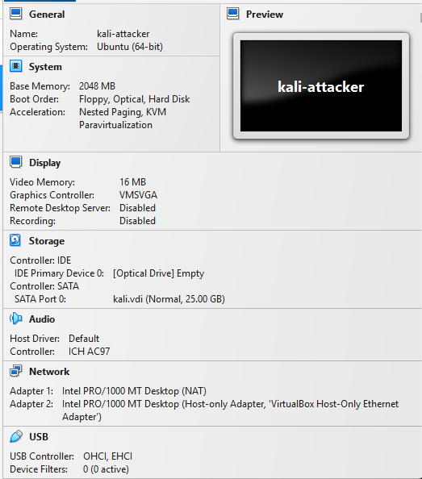
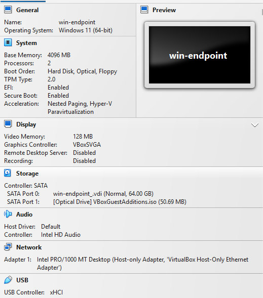
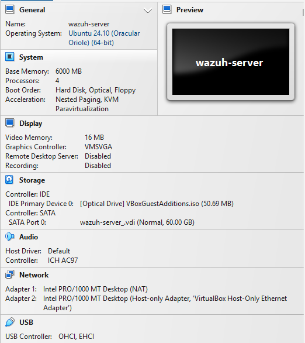
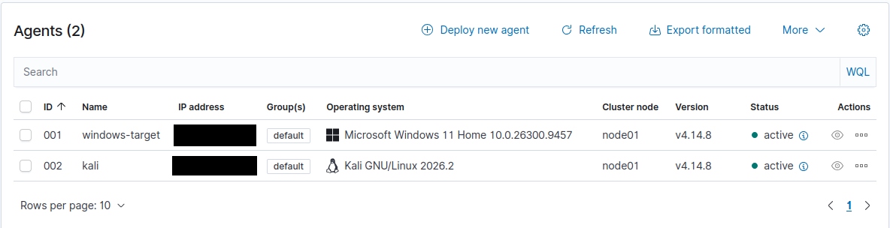
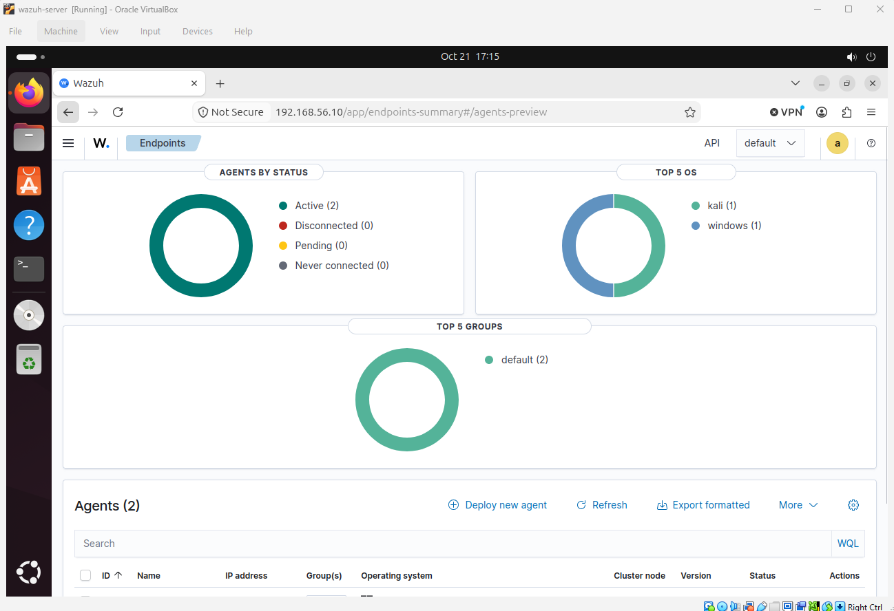
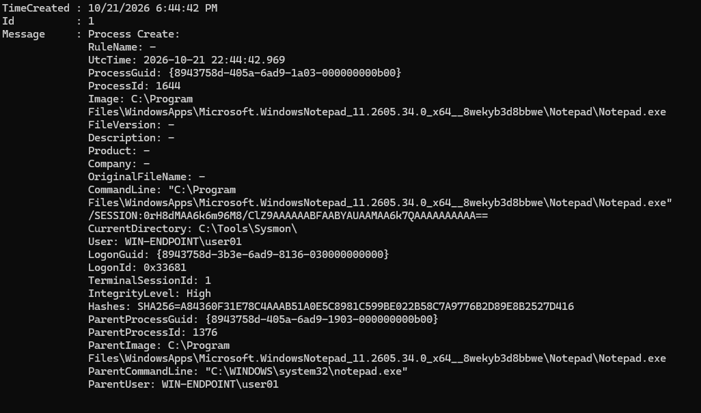
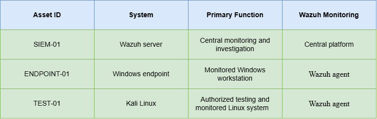

# Home SOC Lab System Inventory

## Inventory Overview

This inventory documents the virtual machines and security components used in my home SOC lab. Sensitive information, including IP addresses, credentials, enrollment keys, tokens, MAC addresses, and other unnecessary system identifiers, has been redacted from the public repository.

## Virtualization Environment

* **Virtualization platform:** Oracle VirtualBox
* **Environment type:** Three-VM home SOC lab
* **Virtual network type:** Oracle VirtualBox Host-only network with NAT access on selected VMs
* **Internet access:** Available to SIEM-01 and TEST-01 through separate NAT adapters
* **Primary purpose:** Defensive security monitoring, detection validation, and SOC investigation practice

The Host-only network provides the primary communication path between the three virtual machines. Separate NAT adapters provide SIEM-01 and TEST-01 with outbound connectivity for authorized updates and package installation.

## Network Configuration Evidence

**Kali Linux Test System**

*Figure 1. TEST-01 uses a NAT adapter for authorized updates and a Host-only adapter for communication with lab systems.*

**Windows Endpoint**

*Figure 2. ENDPOINT-01 uses a Host-only adapter for communication with the Wazuh SIEM and Kali Linux testing system.*

**Wazuh SIEM**

*Figure 3. SIEM-01 uses a NAT adapter for authorized updates and a Host-only adapter for communication with monitored endpoints.*

---
## Wazuh SIEM

The Wazuh virtual machine operates as the Security Information and Event Management platform for the lab. It receives and analyzes security telemetry from the monitored endpoints, applies detection rules, and provides centralized alerting, search, visualization, and investigation capabilities.

* **Asset ID:** SIEM-01
* **VM name:** wazuh-server
* **Hostname:** wazuh-server
* **IP address:** [REDACTED]
* **Operating system:** Ubuntu 24.10
* **Wazuh version:** 4.14
* **Primary role:** Security Information and Event Management platform
* **Current status:** Configured

### Wazuh Agents

*Figure 4. Wazuh agent inventory showing the active Windows and Kali Linux agents. IP addresses were redacted before publication.*

### Wazuh Overview 

*Figure 5. Wazuh dashboard used for centralized endpoint monitoring, alert review, and investigation.*

## Primary Functions

* Log collection and ingestion
* Detection rules and alerting
* Search and visualization
* Investigation and reporting
---
## Windows Endpoint

The Windows virtual machine serves as the primary monitored endpoint. The Wazuh agent collects configured Windows telemetry and forwards it to the Wazuh server for analysis.

* **Asset ID:** ENDPOINT-01
* **VM name:** win-endpoint
* **Hostname:** win-endpoint
* **IP address:** [REDACTED]
* **Operating system:** Windows 11
* **Wazuh agent installed:** Yes
* **Wazuh agent status:** Active
* **Wazuh agent version:** 4.14.8
* **Sysmon status:** Installed and locally validated
* **Primary role:** Monitored Windows workstation
* **Current status:** Configured

### Data Sources

* Windows Security event log
* Windows System event log
* Windows Application event log
* Wazuh agent telemetry
* Sysmon Operational log, when configured
* File Integrity Monitoring, when configured

### Sysmon Validation Evidence

Sysmon was locally validated on ENDPOINT-01 using a controlled Notepad process launch. Sysmon Event ID 1 recorded the process creation and captured the executable path, command line, integrity level, SHA-256 hash, and parent-process information.

Figure 6. Sysmon Event ID 1 recorded the creation of notepad.exe on ENDPOINT-01. The Windows account name was redacted before publication.

---
## Kali Linux Test System

The Kali Linux virtual machine generates safe, controlled security activity against the Windows endpoint within the Host-only lab network. The Wazuh agent also monitors the Kali system and forwards configured Linux telemetry to the Wazuh server. Testing is restricted to systems that I own and operate.

* **Asset ID:** TEST-01
* **VM name:** kali-attacker
* **Hostname:** kali-attacker
* **IP address:** [REDACTED]
* **Operating system:** Kali Linux 2026.2
* **Wazuh agent installed:** Yes
* **Wazuh agent status:** Active
* **Wazuh agent version:** 4.14.8
* **Primary role:** Authorized security-testing and monitored Linux system
* **Current status:** Configured

### Primary Functions

* Generate controlled security activity
* Support Windows detection validation
* Forward configured Linux telemetry to Wazuh
* Support cross-system timeline correlation
* Perform testing only against authorized lab systems
---
## Asset Summary

*Figure 7. Summary of the Wazuh SIEM, Windows endpoint, and Kali Linux testing system.*

## Data Flow Summary

1. TEST-01 generates controlled and authorized activity against ENDPOINT-01.
2. ENDPOINT-01 records relevant Windows and endpoint activity.
3. The Windows Wazuh agent forwards configured telemetry to SIEM-01.
4. The Kali Linux Wazuh agent forwards configured Linux telemetry to SIEM-01.
5. SIEM-01 analyzes, indexes, and displays the collected security data.
6. The analyst reviews the evidence and determines the appropriate alert disposition.

## Inventory Validation Status 

* Wazuh virtual machine created
* Windows virtual machine created
* Kali Linux virtual machine created
* Windows Wazuh agent installed
* Kali Linux Wazuh agent installed
* Wazuh hostname verified
* Windows hostname verified
* Kali Linux hostname verified
* Operating-system versions documented
* Wazuh version documented
* Windows Wazuh agent shown as active
* Kali Linux Wazuh agent shown as active
* Windows log collection validated
* Kali Linux log collection validated
* Oracle VirtualBox network type documented
* System time synchronization validated across all VMs
* Clean snapshots created for all VMs

## Public Documentation Notice

This inventory uses Asset IDs and redacted values to describe the lab without exposing unnecessary system information. Actual network addresses, credentials, authentication keys, and other private identifiers are maintained separately and are not included in this repository.

